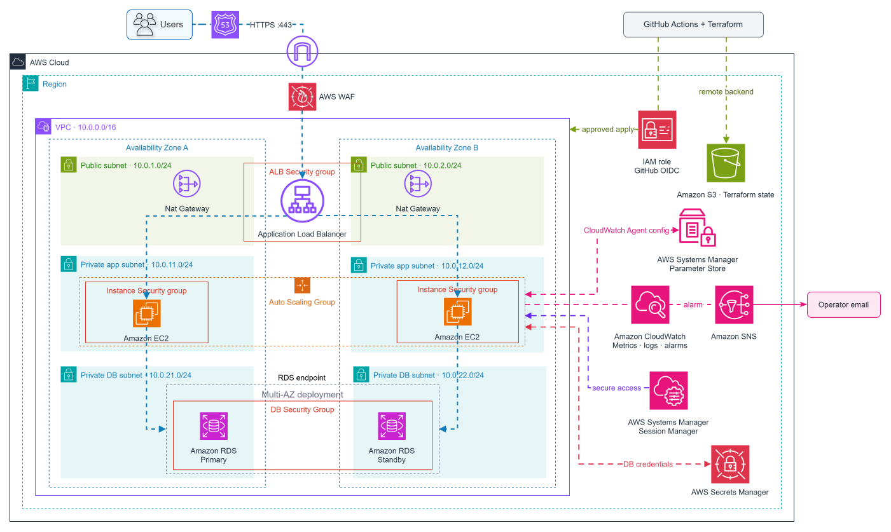

# Resilient Application Infrastructure

## Scenario — What Is the Problem?

A growing company depends on its website to attract customers and receive inquiries. During periods of increased traffic, the website begins slowing down, and an unexpected server failure causes an outage. With no reliable monitoring or alerting, the team learns about the disruption from customers rather than detecting it themselves. Restoring service requires manual intervention, while infrastructure changes are slow, labor-intensive, and prone to mistakes, delaying improvements and increasing the risk of service disruptions. **The company needs a dependable website that can handle growing demand, recover from disruptions, and give its team better visibility and control over operations**—all without increasing staffing requirements, compromising customer information, or incurring excessive costs.

### Solution

Deploy a production-style, **3-tier web application architecture** with a public load balancer, private application servers spanning two Availability Zones, and a private database. Auto Scaling adjusts capacity as demand changes and replaces unhealthy servers, and customer inquiries are securely stored and remain intact when application servers are replaced. CloudWatch centralizes monitoring and logs, alerting the team to operational issues and helping them investigate failures.

Terraform and GitHub Actions automate infrastructure provisioning and delivery, reducing manual effort and accelerating changes through consistent, repeatable processes. Automated checks, reviewable plans, and deployment approvals help ensure those improvements are delivered safely. Configurable redundancy also allows the business to balance reliability with infrastructure costs.

---

## Architecture

*Route 53 directs users to an HTTPS Application Load Balancer protected by AWS WAF. The load balancer distributes requests across EC2 instances in private subnets spanning two Availability Zones, backed by a private RDS MySQL database. Auto Scaling maintains application capacity, CloudWatch provides monitoring and alerts, and Terraform with GitHub Actions manages infrastructure provisioning and delivery.*

Detailed architectural decisions and considerations are documented in [DECISIONS.md](DECISIONS.md).

<strong> Technologies & Services</strong>

- **Terraform** — Defines and provisions the infrastructure as code, supporting configurable deployments and reproducible rebuilds.
- **Amazon VPC** — Provides isolated public, application, and database subnets across two Availability Zones.
- **Amazon Route 53** — Routes the application's domain to the public-facing load balancer.
- **Application Load Balancer (ALB)** — Distributes HTTPS requests across healthy application instances and monitors their health.
- **Amazon EC2 & Auto Scaling** — Hosts the application, automatically replaces unhealthy instances, and adjusts capacity based on demand.
- **Apache & Python** — Serve the website and handle API requests, including database-backed contact submissions.
- **Amazon RDS MySQL** — Stores application data in private database subnets, with Multi-AZ failover support.
- **NAT Gateway** — Provides outbound internet connectivity for private application instances, with configurable redundancy.
- **AWS IAM & Security Groups** — Restrict service permissions and control network access between infrastructure tiers.
- **AWS WAF** — Protects the application through managed security rules and request rate limiting.
- **AWS Certificate Manager (ACM)** — Provides the TLS certificate used for HTTPS connections.
- **AWS Secrets Manager** — Securely stores and provides database credentials to authorized workloads.
- **AWS Systems Manager** — Enables private instance administration through Session Manager and centralized monitoring configuration through Parameter Store.
- **Amazon CloudWatch** — Collects application logs and infrastructure metrics, monitors system health, and triggers operational alarms.
- **Amazon SNS** — Delivers notifications when monitored conditions require attention.
- **Amazon S3** — Stores encrypted, versioned Terraform state with state locking.
- **GitHub Actions & AWS OIDC** — Automates infrastructure checks, planning, and controlled deployments using temporary AWS credentials.

---

## Constraints, Controls & Governance

**Application recovery cannot depend on a single server or manual intervention.**  
A failed server should not leave the business waiting for an engineer to restore service. The Application Load Balancer routes requests to healthy instances, while EC2 Auto Scaling maintains capacity across two Availability Zones and replaces unhealthy instances. Scaling policies adjust capacity as demand changes, and the RDS Multi-AZ configuration provides database failover capability.

**Operational failures must be visible and actionable.**  
A running server doesn't necessarily mean the application is working. CloudWatch collects application logs, infrastructure metrics, and health information to help identify problems and investigate their causes. Three alarms distinguish excessive application errors, prolonged shortages of healthy capacity, and complete loss of healthy instances. SNS notifies the team when these conditions require attention.

**Infrastructure changes must be efficient, repeatable, and intentionally deployed.**  
Manual deployments slow down improvements, while configuration mistakes can disrupt the entire application. GitHub Actions automates Terraform validation, security checks, and change planning, reducing repetitive work and accelerating delivery. Reviewable plans and deployment approvals maintain oversight, while repository-restricted OIDC authentication provides temporary AWS credentials without storing long-lived access keys.

**Internal infrastructure and sensitive data must be protected by layered access controls.**  
Private networking alone isn't enough if permissions allow unauthorized access. The ALB serves as the public entry point, while EC2 instances and RDS remain in private subnets with security groups restricting communication between tiers. IAM roles restrict workloads to necessary permissions, while the Terraform deployment role limits `iam:PassRole` to approved workload roles, and IMDSv2 protects access to instance credentials. Session Manager enables administration without public SSH, and Secrets Manager protects database credentials. Separate database accounts prevent the application from having unnecessary administrative privileges.

**Public application traffic must be encrypted and filtered.**  
Accepting unencrypted traffic or leaving the application without request filtering exposes customers and the business to avoidable risks. The ALB uses an ACM certificate to serve HTTPS and redirects HTTP requests to secure connections. AWS WAF applies managed protections against common web attacks, including SQL injection, alongside rate-based rules to limit abusive traffic.

**Infrastructure must be reproducible without losing persistent resources.**  
Manual provisioning makes environments difficult to recreate consistently, while rebuilding everything from scratch can destroy resources that future deployments depend on. Terraform defines the infrastructure in code and separates persistent resources—such as remote state, DNS, certificates, and application secrets—from application infrastructure. Temporary environments can be removed when no longer needed, avoiding unnecessary costs. Terraform state is stored in S3 with encryption, versioning, restricted access, and locking.

---

<!--
## Results & Validation

---

## Troubleshooting

---

## Key Lessons

---

## Key Lessons

---

## Basic Setup

---
-->
## Infrastructure Validation

The `tests/fixture/` directory contains a small **supporting workload**, not an application-development deliverable. Its health endpoint and synthetic contact submission exercise the infrastructure's routing, instance initialization, secrets access, and RDS persistence. Run `python3 tests/smoke_test.py https://YOUR_CP1_DOMAIN` after deployment and during controlled resilience checks. See [validation fixture](tests/fixture/README.md) for its deployment contract.

---

## Let's Connect

**David Rodriguez | Cloud With David**

[Portfolio](https://cloudwithdavid.com/) | [LinkedIn](https://www.linkedin.com/in/cloudwithdavid/) 
